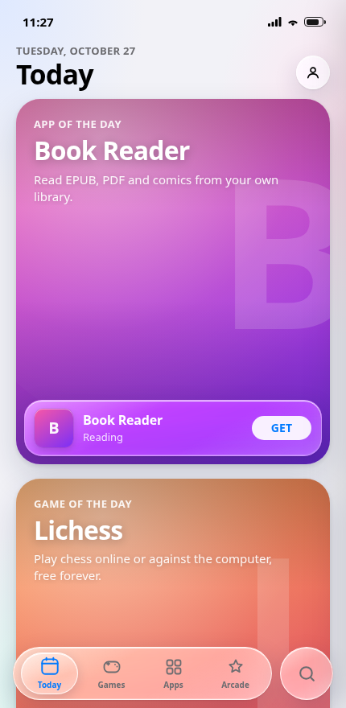
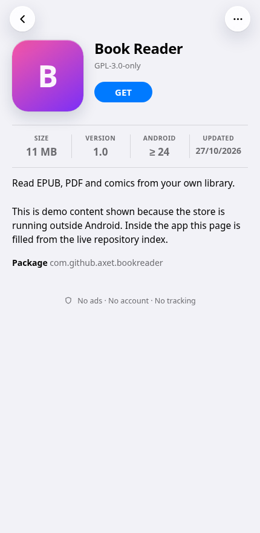
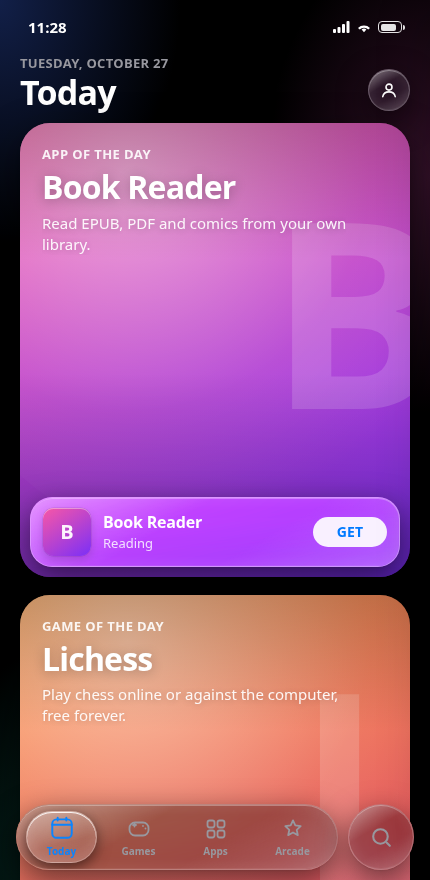
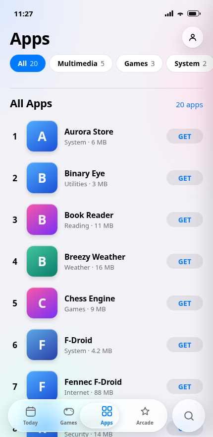
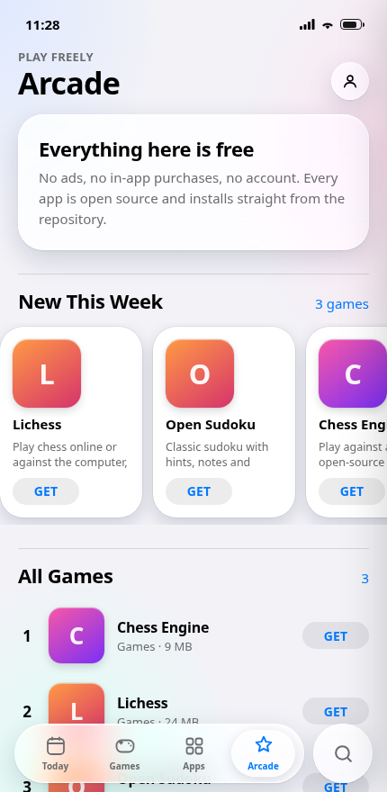
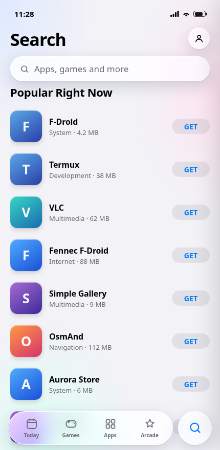

# Liquid Store

An Android app store with a **Liquid Glass** interface, built on F-Droid's public
repository index. No account, no sign-in, no ads, no tracking.

<p align="center">
  
  
  
</p>

## Download

**[LiquidStore.apk](https://github.com/technicalnihilist-lgtm/liquid-store/releases/latest/download/LiquidStore.apk)** &nbsp;·&nbsp; Android 7.0+ (API 24) &nbsp;·&nbsp; ~193 KB

That link always resolves to the newest release. See
[Releases](https://github.com/technicalnihilist-lgtm/liquid-store/releases) for the
version history.

The APK is signed with a self-generated key rather than a Play Store key, so
Android will ask you to allow "install unknown apps" the first time you open it.

## What it does

- **Live catalogue.** Downloads F-Droid's signed `index-v1.jar` and parses it
  *while it streams*, so the store fills in progressively instead of blocking on
  the whole file. Roughly 4,800 installable apps.
- **Mirror racing.** Ten official mirrors are probed in parallel — including two
  in India (Hyderabad, Delhi) and the Cloudflare CDN — and the download starts on
  whichever answers first, with a short grace period in case a faster one is
  still replying. A mirror that is down costs nothing.
- **Real installs.** APKs are downloaded and their SHA-256 is checked against the
  index before the bytes are handed to Android's `PackageInstaller`. Nothing is
  installed that does not match the repository's own hash.
- **App detail.** Screenshots, licence, author, source-code link, size, version
  and minimum Android version, straight from the index.
- **Saved catalogue.** Later launches open instantly from a local copy, and
  refreshes send `If-Modified-Since` / `ETag` so an unchanged index costs one
  round trip instead of a full download.
- **Light and dark.** Light glass by default, following the system preference, with a
  toggle in the toolbar. Both are driven from the same set of colour tokens.
- **Arcade.** A curated games page — newest first, then the full list.
- **Sources screen.** Pin a specific mirror, or enter your own repository address.
- **No account, no login, no ads.** There is nothing to sign into.

## Screenshots

| Today | Apps | App detail |
| --- | --- | --- |
|  |  |  |

| Arcade | Search | Dark theme |
| --- | --- | --- |
|  |  |  |

> The screenshots above were captured from the bundled UI running against a
> small demo catalogue, so the app names are placeholders. The interface, layout
> and behaviour are the real ones.

## Building

No Gradle. The build script drives `aapt2`, `javac`, `d8`, `zipalign` and
`apksigner` directly.

You need:

- JDK 17
- Android SDK **build-tools 34** and **platform 34** (`android.jar`)

```bash
# point these at your SDK and a keystore you own
export ANDROID_JAR=/path/to/platforms/android-34/android.jar
export BUILD_TOOLS=/path/to/build-tools/34.0.0
export KEYSTORE=/path/to/your.keystore
export KS_PASS=your-keystore-password

bash build.sh          # writes LiquidStore.apk
```

`build.sh` generates the keystore on first run if `$KEYSTORE` does not exist.
The password is never stored in the script — supply it through the environment.

## Layout

```
AndroidManifest.xml
src/com/liquid/store/
  MainActivity.java     WebView host, back handling, external links
  StoreBridge.java      everything the UI may do, exposed as window.Android
  IndexLoader.java      mirror probing, index download and streaming parse
  InstallReceiver.java  PackageInstaller result handling
  AppEntry.java         one catalogue entry
res/values/             strings, colours, theme
res/mipmap-*/           launcher icon (transparent background)
assets/index.html       the entire store UI, one self-contained page
assets/fonts/           Plus Jakarta Sans (SIL Open Font License)
```

The UI is a single HTML file. It talks to the native side through
`window.Android`; in a plain browser the same file falls back to a small demo
catalogue, which is how it can be opened and inspected without a device.

## Permissions

| Permission | Why |
| --- | --- |
| `INTERNET` | fetching the index, icons, screenshots and APKs |
| `REQUEST_INSTALL_PACKAGES` | handing a downloaded APK to Android's installer |
| `QUERY_ALL_PACKAGES` | knowing which catalogue apps are already installed |

Installing requires the user to allow "install unknown apps" for this app once;
the store detects that and offers to open the setting.

## Known limitations

- The catalogue is F-Droid, which is free and open-source software only. The
  store deliberately does not carry modified or "premium-unlocked" builds of
  proprietary apps.
- F-Droid's index is large (tens of MB). The first run is a real download; after
  that it is cached.
- The download and install paths have been exercised against local HTTP servers
  and F-Droid's own index fixture, but not yet on physical hardware.
