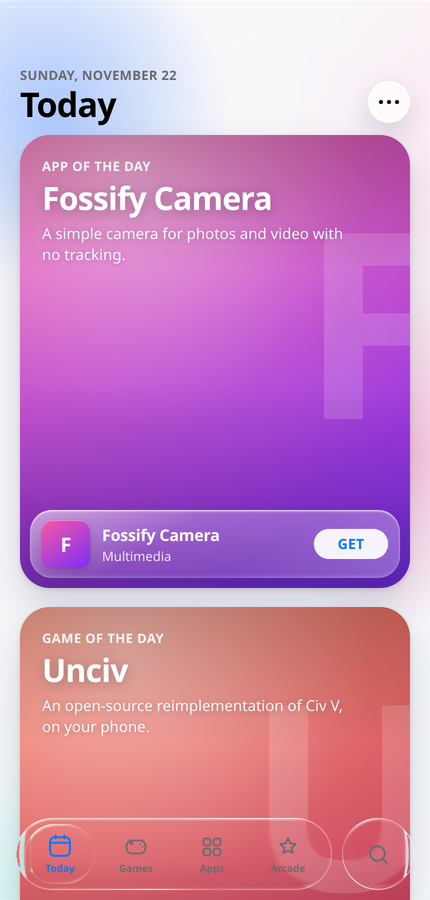
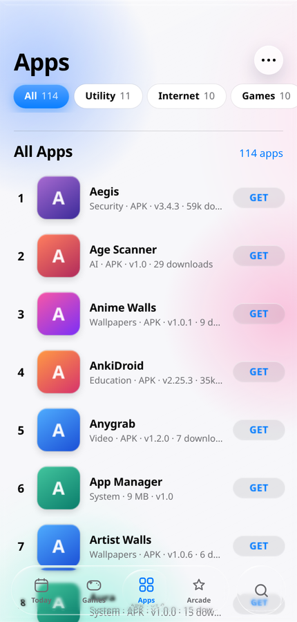
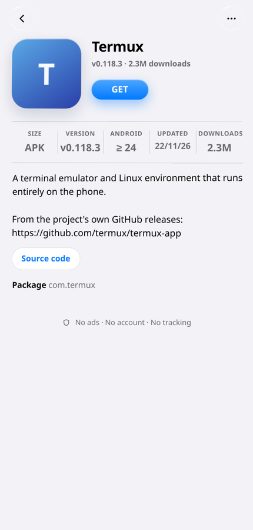
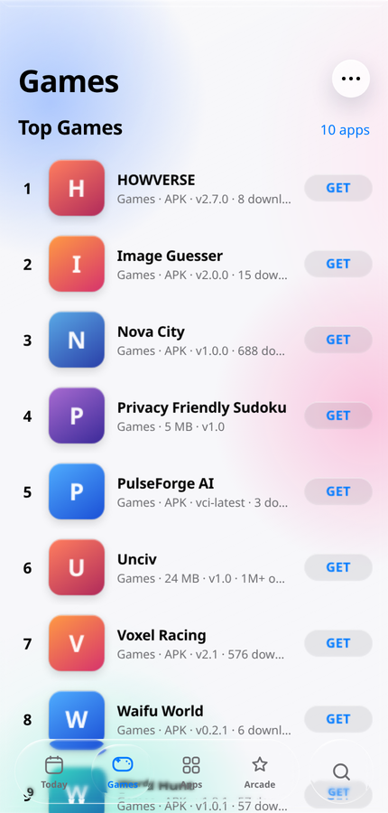
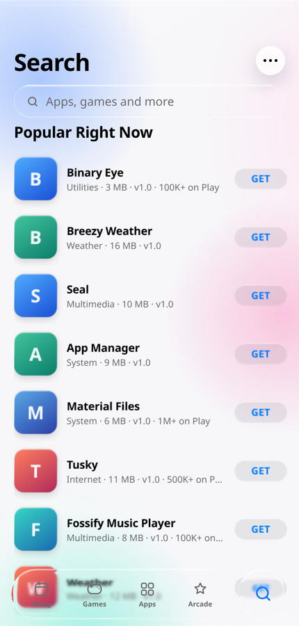
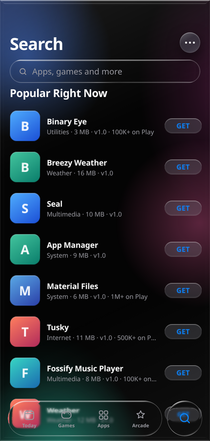

<div align="center">

<a href="https://github.com/technicalnihilist-lgtm/liquid-store/stargazers"></a>&nbsp;<a href="https://github.com/technicalnihilist-lgtm/liquid-store/network/members"></a>

<h3>Android app store with a Liquid Glass interface, built on F-Droid&#x27;s public repository index</h3>

   

<a href="https://github.com/technicalnihilist-lgtm/liquid-store/releases/latest"></a>

<b>Support the work</b>

  

<sub>Donations aren't live yet — Paytm, UPI, PayPal and Buy&nbsp;Me&nbsp;a&nbsp;Coffee all show <b>coming soon</b>. Until then, a ⭐ star is the best support.</sub>

<a href="https://github.com/technicalnihilist-lgtm/liquid-store/releases/latest"></a>  <a href="https://github.com/technicalnihilist-lgtm/liquid-store/releases"></a>

<h4>Get it from</h4>

<a href="https://github.com/technicalnihilist-lgtm/liquid-store/releases"></a> <a href="https://github.com/technicalnihilist-lgtm/liquid-store/archive/refs/heads/main.zip"></a>

</div>

---

---

## Download

**[LiquidStore.apk](https://github.com/technicalnihilist-lgtm/liquid-store/releases/latest/download/LiquidStore.apk)** &nbsp;·&nbsp; Android 7.0+ (API 24) &nbsp;·&nbsp; ~193 KB

That link always resolves to the newest release. See
[Releases](https://github.com/technicalnihilist-lgtm/liquid-store/releases) for the
version history.

The APK is signed with a self-generated key rather than a Play Store key, so
Android will ask you to allow "install unknown apps" the first time you open it.

## What it does

- **Live catalogue.** Downloads F-Droid's signed `index-v1.jar` and parses it
  *while it streams*, so the store fills in progressively instead of blocking on
  the whole file. Roughly 4,800 installable apps.
- **Mirror racing.** Ten official mirrors are probed in parallel — including two
  in India (Hyderabad, Delhi) and the Cloudflare CDN — and the download starts on
  whichever answers first, with a short grace period in case a faster one is
  still replying. A mirror that is down costs nothing.
- **Real installs.** APKs are downloaded and their SHA-256 is checked against the
  index before the bytes are handed to Android's `PackageInstaller`. Nothing is
  installed that does not match the repository's own hash.
- **App detail.** Screenshots, licence, author, source-code link, size, version
  and minimum Android version, straight from the index.
- **Saved catalogue.** Later launches open instantly from a local copy, and
  refreshes send `If-Modified-Since` / `ETag` so an unchanged index costs one
  round trip instead of a full download.
- **Light and dark.** Light glass by default, following the system preference, with a
  toggle in the toolbar. Both are driven from the same set of colour tokens.
- **Arcade.** A curated games page — newest first, then the full list.
- **GitHub releases, alongside F-Droid.** A curated list of open-source projects that
  publish their own APK on GitHub is merged into the same catalogue, so they appear in
  search and in the category lists next to everything else. Results are cached for six
  hours to stay well inside GitHub's unauthenticated rate limit, and the asset's SHA-256
  from the GitHub API is verified on install where the project publishes one.
  The list lives in `assets/github_apps.json` - add a repo there to include it.
- **Sources screen.** Pin a specific mirror, or enter your own repository address.
- **No account, no login, no ads.** There is nothing to sign into.

## Screenshots

| Today | Apps | App detail |
| --- | --- | --- |
|  |  |  |

| Arcade | Search | Dark theme |
| --- | --- | --- |
|  |  |  |

> The screenshots above were captured from the bundled UI running against a
> small demo catalogue, so the app names are placeholders. The interface, layout
> and behaviour are the real ones.

## Building

No Gradle. The build script drives `aapt2`, `javac`, `d8`, `zipalign` and
`apksigner` directly.

You need:

- JDK 17
- Android SDK **build-tools 34** and **platform 34** (`android.jar`)

```bash
## Layout

```
AndroidManifest.xml
src/com/liquid/store/
  MainActivity.java     WebView host, back handling, external links
  StoreBridge.java      everything the UI may do, exposed as window.Android
  IndexLoader.java      mirror probing, index download and streaming parse
  InstallReceiver.java  PackageInstaller result handling
  AppEntry.java         one catalogue entry
res/values/             strings, colours, theme
res/mipmap-*/           launcher icon (transparent background)
assets/index.html       the entire store UI, one self-contained page
assets/fonts/           Plus Jakarta Sans (SIL Open Font License)
```

The UI is a single HTML file. It talks to the native side through
`window.Android`; in a plain browser the same file falls back to a small demo
catalogue, which is how it can be opened and inspected without a device.

## Permissions

| Permission | Why |
| --- | --- |
| `INTERNET` | fetching the index, icons, screenshots and APKs |
| `REQUEST_INSTALL_PACKAGES` | handing a downloaded APK to Android's installer |
| `QUERY_ALL_PACKAGES` | knowing which catalogue apps are already installed |

Installing requires the user to allow "install unknown apps" for this app once;
the store detects that and offers to open the setting.

## Known limitations

- The catalogue is F-Droid, which is free and open-source software only. The
  store deliberately does not carry modified or "premium-unlocked" builds of
  proprietary apps.
- F-Droid's index is large (tens of MB). The first run is a real download; after
  that it is cached.
- The download and install paths have been exercised against local HTTP servers
  and F-Droid's own index fixture, but not yet on physical hardware.

---

---

## 🌍 Languages

<sub>Donations are <b>coming soon</b> in every language below — nothing to pay today, nothing to click.</sub>

<div align="center">

<sub><b>हिन्दी · বাংলা · मराठी · తెలుగు · தமிழ் · ગુજરાતી · ಕನ್ನಡ · മലയാളം · ਪੰਜਾਬੀ · ଓଡ଼ିଆ · অসমীয়া · اردو</b></sub>

</div>

<details>
<summary><b>🌍 Open the same message in 53 languages</b></summary>

**🇮🇳 Indian languages**

- **हिन्दी** (Hindi) — ☕ जल्द ही आ रहा है। · ⭐ अगर आपको यह ऐप और हमारा काम पसंद है, तो कृपया रिपॉजिटरी को स्टार दें और हमें फॉलो करें।
- **বাংলা** (Bengali) — ☕ খুব শিগগিরই আসছে। · ⭐ যদি আপনার এই অ্যাপ এবং আমাদের কাজ ভালো লাগে, তবে অনুগ্রহ করে রিপোজিটরিটিকে একটি স্টার দিন এবং আমাদের ফলো করুন।
- **मराठी** (Marathi) — ☕ लवकरच येत आहे. · ⭐ जर तुम्हाला हे ॲप आणि आमचं काम आवडलं असेल, तर कृपया रिपॉझिटरीला स्टार द्या आणि आम्हाला फॉलो करा.
- **తెలుగు** (Telugu) — ☕ త్వరలో రాబోతోంది. · ⭐ మీకు ఈ యాప్, మా పని నచ్చితే, దయచేసి రిపోజిటరీకి ఒక స్టార్ ఇచ్చి మమ్మల్ని ఫాలో అవ్వండి.
- **தமிழ்** (Tamil) — ☕ விரைவில் வருகிறது. · ⭐ உங்களுக்கு இந்த ஆப்பும் எங்க வேலையும் பிடிச்சிருந்தா, தயவுசெஞ்சு இந்த ரெபாசிட்டரிக்கு ஒரு ஸ்டார்…
- **ગુજરાતી** (Gujarati) — ☕ ટૂંક સમયમાં આવી રહ્યું છે. · ⭐ જો તમને આ એપ અને અમારું કામ ગમતું હોય, તો પ્લીઝ રિપોઝિટરીને સ્ટાર આપો અને અમને ફોલો કરો.
- **ಕನ್ನಡ** (Kannada) — ☕ ಶೀಘ್ರದಲ್ಲೇ ಬರುತ್ತಿದೆ. · ⭐ ನಿಮಗೆ ಈ ಆ್ಯಪ್ ಮತ್ತು ನಮ್ಮ ಕೆಲಸ ಇಷ್ಟವಾದರೆ, ದಯವಿಟ್ಟು ರೆಪೊಸಿಟರಿಗೆ ಸ್ಟಾರ್ ಕೊಡಿ ಮತ್ತು ನಮ್ಮನ್ನು ಫಾಲೋ ಮಾಡಿ.
- **മലയാളം** (Malayalam) — ☕ ഉടൻ വരുന്നു. · ⭐ നിങ്ങൾക്ക് ഈ ആപ്പും ഞങ്ങളുടെ പ്രവർത്തനവും ഇഷ്ടപ്പെട്ടെങ്കിൽ, ദയവായി റെപ്പോസിറ്ററിക്ക് ഒരു സ്റ്റാർ…
- **ਪੰਜਾਬੀ** (Punjabi) — ☕ ਜਲਦੀ ਆ ਰਿਹਾ ਹੈ। · ⭐ ਜੇ ਤੁਹਾਨੂੰ ਇਹ ਐਪ ਅਤੇ ਸਾਡਾ ਕੰਮ ਪਸੰਦ ਹੈ, ਤਾਂ ਕਿਰਪਾ ਕਰਕੇ ਰਿਪੋਜ਼ਟਰੀ ਨੂੰ ਸਟਾਰ ਦਿਓ ਅਤੇ ਸਾਨੂੰ ਫਾਲੋ ਕਰੋ।
- **ଓଡ଼ିଆ** (Odia) — ☕ ଖୁବ୍ ଶୀଘ୍ର ଆସୁଛି। · ⭐ ଯଦି ଆପଣଙ୍କୁ ଏହି ଆପ୍ ଏବଂ ଆମର କାମ ଭଲ ଲାଗୁଛି, ତେବେ ଦୟାକରି ରିପୋଜିଟୋରୀକୁ ଗୋଟିଏ ଷ୍ଟାର୍ ଦିଅନ୍ତୁ ଏବଂ ଆମକୁ ଫଲୋ କରନ୍ତୁ।
- **অসমীয়া** (Assamese) — ☕ অতি সোনকালেই আহি আছে। · ⭐ যদি আপুনি এই এপটো আৰু আমাৰ কাম ভাল পায়, তেন্তে অনুগ্ৰহ কৰি ৰিপজিটৰীটোক এটা ষ্টাৰ দিয়ক আৰু আমাক ফ'ল' কৰক।
- **اردو** (Urdu) — ☕ جلد آرہا ہے۔ · ⭐ اگر آپ کو یہ ایپ اور ہمارا کام پسند آئے تو براہ کرم ریپازٹری کو سٹار دیں اور ہمیں فالو کریں۔
- **संस्कृतम्** (Sanskrit) — ☕ शीघ्रमेव आगच्छति।
- **मैथिली** (Maithili) — ☕ जल्दिये आबि रहल अछि।
- **कोंकणी** (Konkani) — ☕ रोखडेंच येता.
- **کٲشُر** (Kashmiri) — ☕ جَلدی یِوان چھُ۔
- **سنڌي** (Sindhi) — ☕ जल्द अची रह्यो आहे।
- **डोगरी** (Dogri) — ☕ जल्दी आ करदा ऐ।
- **ꯃꯤꯇꯩ ꯂꯣꯟ** (Manipuri) — ☕ ꯑꯊꯨꯕꯥ ꯃꯇꯝꯗꯥ ꯂꯥꯛꯀꯅꯤ꯫
- **बर’** (Bodo) — ☕ थाबैनो फैगोन।
- **ᱥᱟᱱᱛᱟᱲᱤ** (Santali) — ☕ ᱞᱚᱜᱚᱱ ᱦᱤᱡᱩᱜ ᱠᱟᱱᱟ᱾
- **नेपाली** (Nepali) — ☕ छिट्टै आउँदैछ। · ⭐ यदि तपाईंलाई यो एप र हाम्रो काम मन पर्‍यो भने, कृपया रिपोजिटरीलाई स्टार दिनुहोस् र हामीलाई फलो गर्नुहोस्।

**🌍 World languages**

- **العربية** (Arabic) — ☕ قريبًا. · ⭐ إذا أعجبك هذا التطبيق وعملنا، فيرجى منح المستودع نجمة ومتابعتنا.
- **简体中文** (Chinese (Simplified)) — ☕ 即将推出。
- **繁體中文** (Chinese (Traditional)) — ☕ 即將推出。
- **Čeština** (Czech) — ☕ Již brzy.
- **Dansk** (Danish) — ☕ Kommer snart.
- **Nederlands** (Dutch) — ☕ Binnenkort beschikbaar. · ⭐ Vind je deze app en ons werk leuk?
- **Filipino** (Filipino) — ☕ Malapit na.
- **Suomi** (Finnish) — ☕ Tulossa pian.
- **Français** (French) — ☕ Bientôt disponible. · ⭐ Si cette application et notre travail vous plaisent, mettez une étoile au dépôt et suivez-nous.
- **Deutsch** (German) — ☕ Bald verfügbar. · ⭐ Wenn dir diese App und unsere Arbeit gefallen, gib dem Repository einen Stern und folge uns.
- **Ελληνικά** (Greek) — ☕ Έρχεται σύντομα.
- **עברית** (Hebrew) — ☕ בקרוב.
- **Magyar** (Hungarian) — ☕ Hamarosan.
- **Bahasa Indonesia** (Indonesian) — ☕ Segera hadir. · ⭐ Jika kamu suka aplikasi ini dan karya kami, beri bintang pada repositori ini dan ikuti kami.
- **Italiano** (Italian) — ☕ In arrivo.
- **日本語** (Japanese) — ☕ 近日公開。 · ⭐ このアプリと私たちの仕事が気に入ったら、リポジトリにスターを付けてフォローしてください。
- **한국어** (Korean) — ☕ 곧 공개됩니다. · ⭐ 이 앱과 저희 작업이 마음에 드신다면 저장소에 스타를 눌러 주시고 팔로우해 주세요.
- **Bahasa Melayu** (Malay) — ☕ Akan datang.
- **Norsk** (Norwegian) — ☕ Kommer snart.
- **فارسی** (Persian) — ☕ به‌زودی.
- **Polski** (Polish) — ☕ Wkrótce. · ⭐ Jeśli podoba Ci się ta aplikacja i nasza praca, daj repozytorium gwiazdkę i obserwuj nas.
- **Português** (Portuguese) — ☕ Em breve.
- **Română** (Romanian) — ☕ În curând.
- **Русский** (Russian) — ☕ Скоро. · ⭐ Если вам нравится это приложение и наша работа, поставьте звёздочку репозиторию и подпишитесь на нас.
- **Español** (Spanish) — ☕ Muy pronto. · ⭐ Si te gusta esta app y nuestro trabajo, dale una estrella al repositorio y síguenos.
- **Kiswahili** (Swahili) — ☕ Inakuja hivi karibuni.
- **Svenska** (Swedish) — ☕ Kommer snart.
- **ไทย** (Thai) — ☕ เร็ว ๆ นี้
- **Türkçe** (Turkish) — ☕ Çok yakında.
- **Українська** (Ukrainian) — ☕ Незабаром.
- **Tiếng Việt** (Vietnamese) — ☕ Sắp ra mắt. · ⭐ Nếu bạn thích ứng dụng này và công việc của chúng tôi, hãy tặng kho lưu trữ một ngôi sao và theo…

</details>

